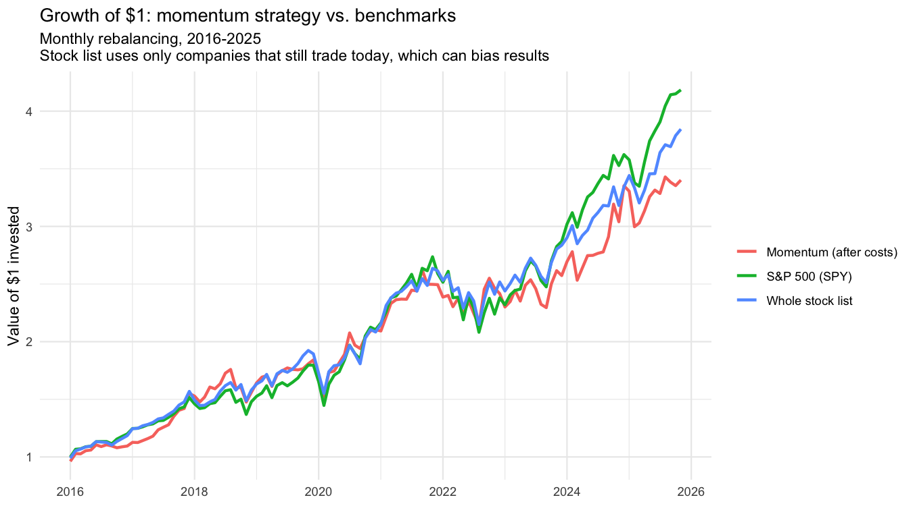

# Momentum Strategy Backtest in R

I built this project to explore a basic investing question: **does buying stocks that have performed relatively well over the previous year lead to better results over the following month?**

A *momentum strategy* ranks investments by their recent performance and buys the strongest performers. This program tests one version of that idea using a fixed list of 40 large U.S. companies. At the end of each month, it ranks the stocks by their adjusted-price return over the previous 12 months, skips the most recent month in that calculation, selects the top eight, and measures how those stocks perform over the next month. It then repeats the process.

The title, **“Momentum Strategy Backtest,”** describes both parts of the project: *momentum strategy* is the investing rule being tested, and a *backtest* applies that rule to historical market data to estimate how it would have performed. The strategy is compared with an S&P 500 fund (SPY) and with an equal-weight portfolio containing all 40 stocks.

This is an educational project, not investment advice or a claim that the strategy will work in the future.

## How the strategy works

1. **Build a stock universe.** Use a fixed list of 40 large U.S. companies.
2. **Calculate momentum.** For each stock, calculate its return over a 12-month window that ends one month before the ranking date.
3. **Select stocks.** Rank eligible stocks and select the eight with the highest momentum scores.
4. **Measure the next month.** Calculate the selected stocks' average next-month return, giving each selected stock equal weight.
5. **Account for estimated trading costs.** Deduct a cost of 0.1% for each stock bought or sold, based on the portfolio's estimated turnover.
6. **Compare results.** Evaluate the strategy before and after estimated costs against SPY and an equal-weight portfolio of the same 40 stocks.
The backtest provides a simplified estimate of how the strategy performed historically. 
It does not guarantee that the results could have been replicated exactly in real-world trading, since execution timing, transaction costs, and the quality of historical market data can affect actual performance.

**Avoiding look-ahead bias:** The strategy ranks stocks using historical adjusted prices and evaluates their subsequent returns. The momentum calculation excludes the most recent month from its lookback window. The timing assumptions still need further verification before the backtest can be treated as a faithful simulation of real-world trading.

## Results from my current run

The script produced 119 monthly observations. The performance figures below are from my current Yahoo Finance data download and may change if the underlying data or cached price file changes.

| Portfolio | Total return | Annualized return | Annualized volatility | Return / volatility | Worst drawdown |
|---|---:|---:|---:|---:|---:|
| Momentum (after estimated costs) | 240.0% | 13.1% | 15.6% | 0.84 | -18.5% |
| Momentum (before estimated costs) | 260.0% | 13.8% | 15.6% | 0.88 | -18.1% |
| All 40 stocks, equal weight | 284.0% | 14.5% | 13.9% | 1.05 | -19.3% |
| S&P 500 (SPY) | 318.0% | 15.5% | 15.0% | 1.03 | -23.9% |

*Return / volatility is annualized return divided by annualized volatility; it is not a Sharpe ratio because it does not subtract a risk-free rate. Drawdown measures the decline from a previous portfolio-value peak.*

**What I learned from the results:** in this run, the momentum portfolio did not outperform either comparison portfolio after estimated trading costs. Its annualized return was 13.1%, compared with 14.5% for the equal-weight stock list and 15.5% for SPY. The results are useful because the backtest evaluates a strategy even though it does not win. They do not establish whether momentum would work with a different stock universe, data source, time period, or set of assumptions.

Full output is saved in `performance_summary.csv` and `backtest_results.csv`.

## Development and testing

I consider myself a **beginner-to-intermediate programmer in Python and R**. I developed this project while learning R and used **Claude AI as a coding assistant** to help with implementation, explain parts of the code, and troubleshoot issues. I ran the script and performed manual checks on selected calculations. AI assistance was part of my development process; it does not mean the code or its outputs are guaranteed to be correct.

I checked several pieces of the program against independently calculated or inspected values:

- **Repeat-run check:** I sourced the script multiple times and checked that it produced the same summary results while using the saved price cache.
- **Momentum calculation:** for AAPL in the June 2020 ranking, the code returned momentum of approximately `0.838`. I independently retrieved the relevant adjusted prices and calculated the return as `0.8377471`, which matches after rounding.
- **Top-eight selection:** I inspected the June 2020 rankings and confirmed that the eight stocks in `picks` matched the eight highest eligible momentum scores for that month.
- **Portfolio return:** I calculated the mean of the eight selected stocks' next-month returns for the June 2020 selection. The result, approximately `0.04075466`, matched the strategy's recorded gross return for that month.
- **Turnover and trading cost:** I compared the June and July 2020 selections. One of the eight positions was new in July, so the turnover calculation was `1 / 8 = 0.125`. The net return also matched the formula subtracting twice the 0.1% per-trade cost multiplied by turnover.
- **Selection count:** I checked the number of selected stocks in every month and confirmed that the minimum and maximum were both eight.
- **Output check:** I verified that the script wrote the chart and the two CSV output files.

These are useful sanity checks, not a comprehensive software test suite. I have not independently verified every row of market data or every possible edge case, so there may still be errors.

## How to run

1. Install R and RStudio.
2. Install the main package and its dependencies by running `install.packages("tidyquant")` in R. If needed, install any other packages named in the script as well.
3. Open `momentum_backtest.R` in RStudio and run it using **Source**.
4. On the first run, the program downloads prices from Yahoo Finance and saves them in `prices_raw.csv`. Later runs reuse that local file. To download a fresh copy, remove the cache file and run the script again.

The script creates:

- `momentum_vs_spy.png` — a chart comparing the growth of $1 across the portfolios.
- `backtest_results.csv` — monthly returns and turnover used in the comparison.
- `performance_summary.csv` — summary performance statistics.
- `prices_raw.csv` — cached raw price data downloaded by the script.

Keep the script and its output files in the same working directory, or configure your RStudio Project so file paths resolve as expected.

## Limitations and assumptions

- **Yahoo Finance data is not guaranteed to be perfect.** Historical prices can be missing, revised, or affected by data-provider issues and corporate actions. The program checks for missing adjusted prices and warns if a ticker did not download, but these checks cannot guarantee that all data is correct. A cached file can also become stale. The results should be treated as estimates based on the data available to the script, not as authoritative market records.
- **Survivorship bias.** The list contains companies that still trade today. Companies that failed, were delisted, or were acquired may be absent, which can make historical results look better than a strategy using a historically accurate stock universe would have. The list also may omit companies that were smaller in 2015 and later grew substantially.
- **The stock list is not historical S&P 500 membership.** I selected the companies as a fixed list of mostly large firms associated with the 2015 period; it is not a verified reconstruction of the index at each point in time.
- **Simplified transaction costs.** The model applies a flat 0.1% cost to each purchase and sale using estimated turnover. It does not model changing bid-ask spreads, market impact, taxes, or every real-world trading expense. The initial portfolio's cost treatment is also simplified.
- **Limited testing period.** The historical window includes unusual market conditions, including the COVID-19 crash and recovery. Results over this period may not generalize to other periods.
- **No out-of-sample evaluation.** The project reports one set of strategy settings: a 12-month lookback, a one-month skip, and eight holdings. It has not yet been tested on a separate untouched period.
- **Simplified performance statistics.** The return-to-volatility figure is not a risk-adjusted return measure such as the Sharpe ratio. The backtest also does not model every practical portfolio-management detail.

## Possible next steps

- Use a point-in-time stock universe to reduce survivorship bias.
- Compare the results across different lookback periods and portfolio sizes, reporting all tested configurations.
- Separate the data into a strategy-development period and an untouched evaluation period.
- Add more systematic automated tests and checks for missing dates, duplicate observations, and unusual returns.
- Compare against additional benchmarks, including a published momentum factor series.

## Skills and concepts explored

R; `tidyquant`, `dplyr`, `tidyr`, `lubridate`, `readr`, and `ggplot2`; financial data retrieval and caching; adjusted-price returns; monthly portfolio construction; momentum ranking; transaction-cost estimates; benchmark comparisons; visualization; and validation checks.
